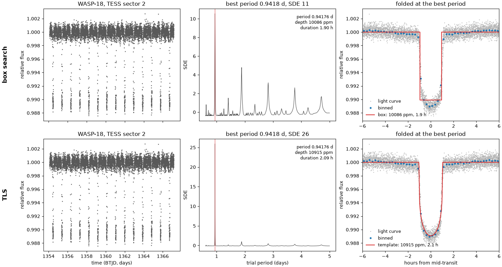

# transitgpu

transitgpu searches light curves for transiting planets with Box Least Squares (BLS) and Transit Least Squares (TLS) written for PyTorch. It runs on CUDA and ROCm GPUs and on the CPU.

If you use transitgpu, please cite [Parallel Search for Alien Worlds: GPU-Accelerated BLS and TLS for Exoplanet Transit Detection](paper/main.pdf).

Tested on one AMD GPU (gfx1100, ROCm 7.2); not yet tested on NVIDIA. On other devices the package uses only its Triton kernels, which Triton also compiles for NVIDIA GPUs; its one HIP kernel, a faster accumulation of the box search, runs only on ROCm and uses no AMD-specific instruction.

## Why

A transiting planet dims its star by a fraction of a percent for a few hours per orbit, so finding one means folding the light curve at tens of thousands of trial periods and scoring every plausible dip at each. The cost adds up with multi-year light curves, with injection–recovery tests and with false-alarm thresholds built from many shuffled copies of each light curve.

transitgpu moves these searches to the GPU:

- **`transitgpu.tls`**: TLS 2.0.1 with the search over trial periods running on the GPU. Change the import and the rest of a TLS script works as before. The default `gpu` backend reproduces TLS's exact backend; `gpu-binned` is faster but approximate.
- **Box search**: a phase-binned BLS on TLS's period grid with integer sums. It returns its results under TLS's attribute names.
- **Hybrid search**: the box search over the whole grid, then exact TLS on a narrow window around each of the strongest peaks.



WASP-18 b in 13 days of TESS data. Top: the box search; bottom: TLS on the GPU. Each row shows the light curve, the periodogram with the best period marked, and the light curve folded at that period with the fitted model. Made with `examples/plot_wasp18.py`.

## Installation

transitgpu is not on PyPI yet; install it from this repository. Install the torch build for your device first, then transitgpu ([uv's PyTorch guide](https://docs.astral.sh/uv/guides/integration/pytorch/)). Use the index of your torch build (`rocm7.2` here, `cu128` for NVIDIA, `cpu` for the CPU); `[tls]` adds `transitgpu.tls` and its dependency, TLS 2.0.1:

```text
uv pip install torch --index-url https://download.pytorch.org/whl/rocm7.2
uv pip install "transitgpu[tls] @ git+https://github.com/mauri870/transitgpu"
```

transitgpu needs Python 3.12+ and torch 2.5+.

On ROCm, `search_many` accumulates in a HIP kernel that is compiled with `hipcc` on the first call (about 20 s, once per environment; `TORCH_EXTENSIONS_DIR` moves the build). Without `hipcc` a warning is shown once and the Triton kernel is used, as it is on NVIDIA. Without Triton, the search folds into a table and compiles the fold with `torch.compile`. On the CPU, the first search of a process compiles the box search with `torch.compile`, which needs a C++ compiler; without one a warning is shown once and the search runs uncompiled. Please report problems at https://github.com/mauri870/transitgpu/issues.

## Getting started

The examples below use the WASP-18 light curve in `examples/data/wasp18_s2.npz`, which is in the repository and not in the wheel, so clone the repository first:

```text
git clone https://github.com/mauri870/transitgpu
cd transitgpu
```

`uv run --group rocm python examples/wasp18_b.py` runs all the examples below and prints their output (`--group cu128` for NVIDIA, `--group cpu` for the CPU).

```python
import numpy as np

import transitgpu

data = np.load("examples/data/wasp18_s2.npz")  # time in days (BTJD), flattened PDCSAP flux, error of the flux
t, y, dy = data["time"], data["flux"], data["flux_err"]
results = transitgpu.box_search(t, y, dy).power(period_min=0.5, period_max=5.0)  # on the first GPU, else the CPU
print(f"period    {results.period:.5f} d")
print(f"duration  {results.duration * 24:.2f} h")
print(f"depth     {(1 - results.depth) * 1e6:.0f} ppm")
print(f"SDE       {results.SDE:.1f}")
```

```text
period    0.94176 d
duration  1.90 h
depth     10086 ppm
SDE       10.6
```

The NASA Exoplanet Archive lists WASP-18 b at 0.94145 d.

Add `bumps=True` to search for brightenings too, from the same fold, in about 3 to 8% more time (the table under Performance). `results.bump` holds the results of the best brightening; `transitgpu.search(t, y, 0.5, 5.0, bumps=True)["bump"]` is the same as a dict. Its SDE is the z-score of the best bump statistic of each period, and its depth is above 1 for a brightening.

```python
results = transitgpu.box_search(t, y, dy).power(period_min=0.5, period_max=5.0, bumps=True)
print(f"bump      {results.bump.period:.5f} d")
print(f"SDE       {results.bump.SDE:.1f}")
```

```text
bump      1.41188 d
SDE       2.3
```

With errors, each point is weighted by 1/dy², rounded to multiples of 1/64 of the median weight and clipped to between 1/64 and 64 times it.

A weight of 0 masks its point. To search one light curve with several sets of weights, for example one mask for each of several events, give `transitgpu.search_many(t, [y], 0.5, 14.0, weights=weights)` a matrix with one row of weights for each result; each result is that of a search with that row, and a batch of five takes 0.69 to 0.81 of the time of five separate searches (the fourth table under Performance).

For TLS, change the import:

```python
from transitgpu.tls import transitleastsquares

results = transitleastsquares(t, y, dy).power(period_min=0.5, period_max=5.0, verbose=False)
print(f"period    {results.period:.5f} d")
print(f"duration  {results.duration * 24:.2f} h")
print(f"depth     {(1 - results.depth) * 1e6:.0f} ppm")
print(f"SDE       {results.SDE:.1f}")
```

```text
period    0.94176 d
duration  2.09 h
depth     10915 ppm
SDE       25.9
```

The default backend is `"gpu"`, which gives the same χ² as TLS's exact backend. `backend="gpu-binned"` is faster and approximate: it folds the points into phase bins, needs equal errors, and can find a different best period on light curves with gaps or few points. `backend="gpu-pl"` is TLS's default backend (`fused-pl`) on the GPU and needs equal errors. It runs only on a GPU. Any other TLS backend can be selected by name, and the environment variable `TLS_BACKEND` sets the backend when the call gives none.

The two SDEs above are different statistics: the box search's is a plain z-score of its periodogram, and TLS's is computed after removing a running median. Compare each one only with a threshold made for the same search.

The hybrid search runs the box search over the whole grid, then TLS on a window of ±1% around each of the strongest peaks to refine the period, epoch, duration and depth. It needs the `tls` extra.

```python
found = transitgpu.bls_tls_hybrid(t, y, dy, period_min=0.5, period_max=5.0, peaks=3)
for peak in found.peaks:  # strongest first; peak.tls is TLS's results object, or None with peak.reason
    if peak.tls is not None:
        print(f"peak {peak.rank}: box {peak.box_period:.5f} d (SDE {peak.box_sde:.1f}), TLS {peak.tls.period:.5f} d, {peak.tls.duration * 24:.2f} h")
```

```text
peak 0: box 0.94176 d (SDE 10.6), TLS 0.94176 d, 2.01 h
peak 1: box 1.88451 d (SDE 4.8), TLS 1.88451 d, 2.09 h
peak 2: box 2.82748 d (SDE 3.2), TLS 2.82748 d, 2.03 h
```

Each peak's SDE comes from the box search. If TLS cannot refine a peak, the peak keeps its box values and `peak.reason` says why.

To estimate whether a signal that transitgpu finds is a false positive (an eclipsing binary, a blend with a nearby star or a companion of the target), [velociraptor](https://github.com/mauri870/velociraptor) runs the likelihoods of [TRICERATOPS](https://github.com/stevengiacalone/triceratops) on a GPU.

### Choosing the device

Every search runs on the first GPU that torch finds, or on the CPU without one. `device` picks the device, and a TLS backend takes it the same way:

```python
from transitgpu import engine

results = transitgpu.box_search(t, y, dy).power(period_min=0.5, period_max=5.0, device="cpu")
found = transitgpu.search(t, y, 0.5, 14.0, device="cuda")
results = transitleastsquares(t, y, dy).power(period_min=0.5, period_max=5.0, backend=engine.WindowBackend(device="cpu"))
```

On the CPU the examples above print the same output in about 40 s on an AMD Ryzen 9 9950X3D, 28 s of it in TLS.

### Detrending

`transitgpu.detrend.biweight` computes the trend of wotan's biweight filter on the GPU, or on the CPU without one. It uses the windows, the mask and the stopping step of `wotan.flatten(time, flux, method="biweight", window_length=window, return_trend=True)`, and its NaN positions are wotan's. `biweight_many` takes a list of light curves, for example the sectors of one star, and returns one trend for each.

```python
from transitgpu import detrend

trend = detrend.biweight(time, flux, 0.75, mask=in_transit)  # window of 0.75 d; mask leaves the points of known transits out of the windows
flattened = flux / trend
trends = detrend.biweight_many([(time_1, flux_1), (time_2, flux_2)], 0.75)
```

On a GPU a Triton kernel computes the trend when the widest window, rounded up to a power of two, holds at most `detrend.KERNEL_WIDTH_LIMIT` points; a wider window, such as 0.75 d at 20 s cadence, runs the torch version on the GPU. The first call of the kernel at a width compiles it, longer for wider windows: 34.3 s at 2,048 points from an empty cache (the sixth table under Performance). Triton keeps the compiled kernel on disk for later processes. On the CPU the trend is wotan's own when wotan is installed: it gives wotan's numbers exactly and is faster than the torch version at 2-minute cadence, while at 10 min and 200 s the torch version is faster (`method="torch"`, the sixth table). Without wotan the torch version runs. `method="kernel"`, `"torch"` or `"wotan"` chooses the path.

On a GPU that also drives a display, several processes launching the kernel at once can time out the GPU's graphics ring and reset it; detrend from one process per such GPU.

## Performance

The benchmark input is N evenly spaced points over 1,000 days with 1,000 ppm of white noise and one injected box (3.18 d, 3,000 ppm, 2.5 h). Every search covers TLS's 91,607 trial periods from 0.5 to 14 days, and every one finds the injected period. A time is the median of seven runs in seconds; where a cell has brackets, they hold the first and third quartiles.

| search | device | 20,000 points | 100,000 points | 200,000 points |
| --- | --- | --- | --- | --- |
| transitgpu box search | GPU | 0.223 (0.223–0.224) | 0.333 (0.333–0.336) | 0.477 (0.476–0.479) |
| transitgpu.bls_tls_hybrid, 5 peaks, window 1%, exact | GPU | 0.407 (0.406–0.409) | 0.697 (0.673–0.708) | 1.06 (1.06–1.13) |
| transitgpu.tls exact | GPU | 2.57 (2.57–2.58) | 5.33 (5.32–5.34) | 9.91 (9.90–9.94) |
| transitgpu.tls binned | GPU | 1.11 (1.11–1.12) | 1.37 (1.37–1.37) | 1.48 (1.47–1.48) |
| transitgpu.tls piecewise-linear | GPU | 1.24 (1.24–1.24) | 4.08 (4.08–4.09) | 6.77 (6.76–6.78) |
| astropy BoxLeastSquares | CPU, 1 thread | 37.2 (37.2–37.2) | 51.3 (51.3–51.4) | 69.1 (69.1–69.2) |
| transitleastsquares 2.0.1 exact (fused) | CPU, 16 threads | 6.54 (6.54–6.57) | 12.5 (12.4–12.5) | 27.7 (27.5–27.7) |
| transitleastsquares 2.0.1 default (fused-pl) | CPU, 16 threads | 1.47 (1.47–1.47) | 4.09 (4.08–4.10) | 10.8 (10.7–10.9) |
| transitleastsquares 2.0.1 exact (fused) | CPU, 1 thread | 91.0 (90.9–91.2) | 166 (166–166) | 277 (276–278) |
| transitleastsquares 2.0.1 default (fused-pl) | CPU, 1 thread | 20.2 (20.1–20.2) | 49.1 (49.0–49.2) | 85.6 (84.2–85.9) |

Like for like, on 16 CPU threads, at 20,000, 100,000 and 200,000 points (the time of transitgpu over the time of TLS):

- `transitgpu.tls` exact against TLS's exact backend (`fused`), which gives the same χ²: 0.39, 0.43, 0.36.
- `backend="gpu-pl"` against TLS's default backend (`fused-pl`), the same statistic: 0.84, 1.00, 0.63.
- `transitgpu.tls` exact against TLS's default backend: 1.74, 1.30, 0.92. The exact device search is not faster than TLS's default backend on 16 threads below 200,000 points.
- `transitgpu.tls` binned against `fused-pl` compares speed only, since the binned statistic is different.

The box search and the hybrid compute a different statistic from TLS, so their rows show what a box search costs next to a template search, not a speed-up of TLS. On average the box search scores 24 durations per period, astropy 37, and both TLS implementations 38 with the transit template. The box row does not include generating the period grid.

The second table shows a batch of 64 light curves of 20,000 points, each with its own noise and the same injected box. transitgpu searches them in a single `search_many` call; TLS runs `power()` on one light curve after another. Times are in seconds for the whole batch.

| search | device | seconds for the set | light curves per second |
| --- | --- | --- | --- |
| transitgpu.search_many, box search (a different statistic from TLS's) | GPU | 5.24 (5.23–5.24) | 12.2 |
| transitleastsquares 2.0.1 default (fused-pl), one after another | CPU, 16 threads | 92.4 (92.3–92.4) | 0.693 |

Machine: AMD Ryzen 9 9950X3D and AMD Radeon RX 7900 XTX, ROCm 7.2.53211, Python 3.12.13, numpy 2.5.4, torch 2.12.0+rocm7.2, triton 3.7.0, astropy 8.0.2, transitleastsquares 2.0.1 and numba 0.68.0. The GPU rows and the 16-thread TLS rows of the first table and the GPU row of the second come from one session of 2026-11-05, each process pinned to cores 0–15 of the otherwise idle machine. The astropy rows, the one-thread TLS rows and the 16-thread TLS row of the second table come from the session of 2026-10-26 (astropy 8.0.1), and each of those rows carries the session it was measured in. `benchmarks/results.json` has every run and the log of the session. To reproduce:

```
bash benchmarks/session.sh DIRECTORY
uv run --group rocm python benchmarks/assemble.py DIRECTORY --out benchmarks/results.json
uv run --group rocm python -c "import json, sys; sys.path.insert(0, 'benchmarks'); import bench; r = json.load(open('benchmarks/results.json')); print(bench.performance_table(r)); print(bench.throughput_table(r))"
```

The third table times the dips and the bumps of one light curve, on the input of the first table. Its rows are from one session of 2026-10-27 on the same machine, with ROCm 7.2.53211, Python 3.13.12, numpy 2.5.4, torch 2.12.0+rocm7.2 and triton 3.7.0, the GPU to itself. `benchmarks/results-bumps.json` has every run.

| search of one light curve | 20,000 points | 100,000 points | 200,000 points |
| --- | --- | --- | --- |
| `transitgpu.search`, dips only | 0.237 (0.237–0.241) | 0.468 (0.464–0.470) | 0.544 (0.540–0.545) |
| `transitgpu.search` with `bumps=True`, dips and bumps in one search | 0.255 (0.254–0.257) | 0.489 (0.483–0.490) | 0.560 (0.556–0.561) |
| two `transitgpu.search` calls, of the flux and of the negated flux | 0.476 (0.475–0.477) | 0.940 (0.936–0.951) | 1.10 (1.09–1.10) |

```
uv run --group rocm python benchmarks/bench.py --refuse-if-busy --rows gpu gpu-bumps gpu-two --repeats 7 --json bench-bumps-final.json
```

The fourth table times one light curve searched with five weight vectors, each with a weight of 0 at 60 points (a mask), on the input of the first table. `search_many` with one flux and a matrix of weights, one row for each result, folds the times once and gives for each row the result of the search with that row; a separate search folds them again. The rows are from the same session and machine as the third table. `benchmarks/results-weights.json` has every run.

| search of one light curve with weight vectors | 20,000 points | 100,000 points | 200,000 points |
| --- | --- | --- | --- |
| `transitgpu.search`, one search | 0.238 (0.238–0.240) | 0.468 (0.464–0.472) | 0.549 (0.546–0.550) |
| `transitgpu.search_many`, one flux and 5 weight vectors in one call | 0.822 (0.820–0.823) | 1.86 (1.85–1.86) | 2.21 (2.20–2.21) |
| 5 `transitgpu.search` calls, one for each weight vector | 1.20 (1.19–1.22) | 2.36 (2.36–2.36) | 2.74 (2.72–2.75) |

```
uv run --group rocm python benchmarks/bench.py --refuse-if-busy --rows gpu gpu-weights gpu-weights-separate --repeats 7 --json bench-weights.json
```

The fifth table times the search of stacks of 312,500 to 2,525,000 points (25 s cadence, white noise of 1,000 ppm, periods from 0.5 to 14 d). The search takes at most 512 periods a launch and fewer when 512 would visit more than `transitgpu.core.ONE_PASS_ELEMENTS` (160 million) period and point pairs, so that no launch of a long stack runs much past 10 ms, which a GPU that also drives a display tolerates. The result of a search does not depend on the number of periods a launch. "512 always" is the search with the budget removed, run up to 1,000,000 points. The sizes of the other tables, up to 200,000 points, take 512 periods a launch in both columns. The rows are from one session of 2026-11-03 on the machine of the third table, the GPU to itself, with ROCm 7.2.53211, torch 2.12.0+rocm7.2 and triton 3.7.0. `benchmarks/results-launches.json` has every run.

| points | periods a launch, 512 always | periods a launch, bounded | largest launch, 512 always (ms) | largest launch, bounded (ms) | search, 512 always (s) | search, bounded (s) |
| --- | --- | --- | --- | --- | --- | --- |
| 312,500 | 512 | 512 | 5.3 | 5.3 | 0.0889 | 0.0884 |
| 350,000 | 512 | 457 | 6.6 | 5.6 | 0.111 | 0.113 |
| 450,000 | 512 | 355 | 8.5 | 5.9 | 0.174 | 0.180 |
| 1,000,000 | 512 | 160 | 19.8 | 6.5 | 0.777 | 0.819 |
| 1,300,000 | - | 123 | - | 7.5 | - | 1.36 |
| 2,000,000 | - | 80 | - | 9.2 | - | 3.17 |
| 2,525,000 | - | 63 | - | 9.0 | - | 5.04 |

```
uv run --group rocm python benchmarks/launch_compare.py --sizes 312500 350000 450000 1000000 1300000 2000000 2525000 --repeats 7 --json results-launches.json
```

The sixth table times one biweight detrend of a sector of 27.4 days (Gaussian noise of 1,000 ppm, a sine of 2,000 ppm, transits of 3,000 ppm that are masked, a gap of a day, 1 point in 500 a NaN) at each cadence and window, from the arrays on the host to the trend on the host. A cell is the median of seven calls after the first, in milliseconds, with the minimum and maximum in brackets. The width is the widest window in points, rounded up to a power of two; the kernel takes widths up to `detrend.KERNEL_WIDTH_LIMIT`, and at 20 s the call takes the torch version on the GPU. The first call of the kernel at 2,048 points from an empty Triton cache took 34.3 s. torch on the CPU ran with torch's default threads, 16 on this machine (`torch.get_num_threads()`), which the session did not record. The rows are from one session of 2026-11-08 on the machine of the third table, the GPU to itself, each configuration its own process, with ROCm 7.2.53211, Python 3.12.13, numpy 2.5.4, torch 2.12.0+rocm7.2, triton-rocm 3.7.0, numba 0.68.0 and wotan 1.10, on an AMD Radeon RX 7900 XTX. `benchmarks/results-detrend.json` has every call.

| detrend of one sector | 30 min, 0.75 d (1,249 points, width 64) | 10 min, 0.75 d (3,745 points, width 128) | 200 s, 0.75 d (11,233 points, width 512) | 2 min, 0.75 d (18,721 points, width 1,024) | 2 min, 1.5 d (18,721 points, width 2,048) | 20 s, 0.75 d (112,321 points, width 4,096) |
| --- | --- | --- | --- | --- | --- | --- |
| wotan 1.10, CPU, 1 thread | 1.97 (1.96–2.04) | 10.8 (10.8–11) | 80.4 (80.2–82.2) | 219 (219–219) | 400 (400–401) | 6,855 (6,854–6,861) |
| transitgpu.detrend, torch on the CPU, torch's default threads | 1.96 (1.95–2.24) | 6.21 (5.89–6.27) | 61.9 (57.2–67.2) | 353 (348–379) | 766 (752–773) | not run |
| transitgpu.detrend, Triton kernel on the GPU | 0.249 (0.231–0.514) | 0.487 (0.425–0.93) | 2.39 (1.28–2.75) | 3.59 (3.33–5.85) | 8.58 (8.33–8.76) | over the limit |
| transitgpu.detrend, torch on the GPU | 2.36 (1.57–2.51) | 2.5 (1.72–2.67) | 7.73 (6.66–10.5) | 13.7 (13.5–18.5) | 37.3 (36.9–40.1) | 612 (611–612) |

Largest difference from wotan's trend, relative to the trend: 2.2e-16; the NaN positions are equal in every row.

```
for index in 0 1 2 3 4; do uv run --group rocm python benchmarks/bench_detrend.py --repeats 7 --configuration $index --json part$index.json; done
uv run --group rocm python benchmarks/bench_detrend.py --repeats 7 --configuration 5 --rows torch-device --json part5.json
uv run --group rocm python benchmarks/bench_detrend.py --merge benchmarks/results-detrend.json part0.json part1.json part2.json part3.json part4.json part5.json
```

## Tests

From a clone, run `uv run --group rocm pytest`, or use `--group cu128` or `--group cpu` for other torch builds. Without a group, uv installs PyPI's default torch, which is the NVIDIA build. CI runs the suite on the CPU; `tests/test_tls_golden.py` checks `transitgpu.tls` against TLS's exact backend on TLS's 14 test cases, field by field.

## Attribution

The box statistic is that of Kovács, Zucker and Mazeh (2002, A&A 391, 369). The template search is Transit Least Squares (Hippke and Heller 2019, A&A 623, A39) and its period grid is Ofir (2014, A&A 561, A138). The layout of the search on a GPU follows GTLS (Hu et al. 2026, arXiv:2607.00348).

## Licence

The package is MIT licensed (`LICENSE`). The grids and the period uncertainty are copied from TLS 2.0.1, which is MIT licensed too, and its notice is in `THIRD_PARTY/TLS-LICENSE`.
