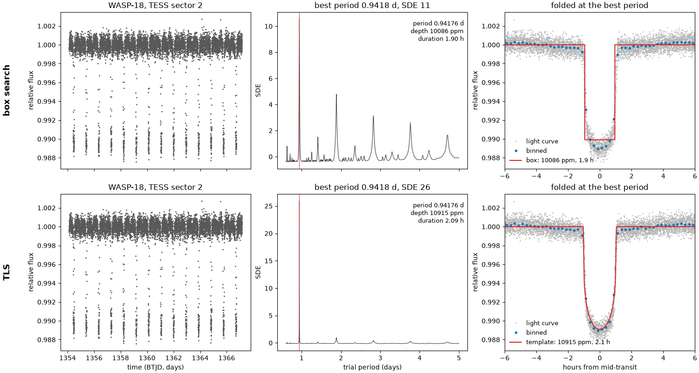

# transitgpu

transitgpu is a parallel search for alien worlds: Box Least Squares (BLS) and Transit Least Squares (TLS) for exoplanet transit detection, accelerated on the GPU with PyTorch for CUDA and ROCm.

Tested on one AMD GPU (gfx1100, ROCm 7.2); not yet tested on NVIDIA. On other devices the package uses only its Triton kernels, which Triton also compiles for NVIDIA GPUs; its one HIP kernel, a faster accumulation of the box search, runs only on ROCm and uses no AMD-specific instruction.

## Why

A transiting planet dims its star by a fraction of a percent for a few hours per orbit, so finding one means folding the light curve at tens of thousands of trial periods and scoring every plausible dip at each. The cost adds up with multi-year light curves, with injection–recovery tests and with false-alarm thresholds built from many shuffled copies of each light curve.

transitgpu moves these searches to the GPU:

- **`transitgpu.tls`**: TLS 2.0.1 with the search over trial periods running on the GPU. Change the import and the rest of a TLS script works as before. The default `gpu` backend reproduces TLS's exact backend; `gpu-binned` is faster but approximate.
- **Box search**: a phase-binned BLS on TLS's period grid with integer sums. It returns its results under TLS's attribute names.
- **Hybrid search**: the box search over the whole grid, then exact TLS on a narrow window around each of the strongest peaks.



WASP-18 b in 13 days of TESS data. Top: the box search; bottom: TLS on the GPU. Each row shows the light curve, the periodogram with the best period marked, and the light curve folded at that period with the fitted model. Made with `examples/plot_wasp18.py`.

## Installation

transitgpu is not on PyPI yet; install it from this repository. Install a GPU build of torch first, then transitgpu ([uv's PyTorch guide](https://docs.astral.sh/uv/guides/integration/pytorch/)). Use the index of your torch build (`rocm7.2` here, `cu128` for NVIDIA); `[tls]` adds `transitgpu.tls` and its dependency, TLS 2.0.1:

```text
uv pip install torch --index-url https://download.pytorch.org/whl/rocm7.2
uv pip install "transitgpu[tls] @ git+https://github.com/mauri870/transitgpu"
```

transitgpu needs Python 3.12+, torch 2.5+ and a CUDA or ROCm GPU. Without a GPU, use astropy's `BoxLeastSquares` or `transitleastsquares`.

On ROCm, `search_many` accumulates in a HIP kernel that is compiled with `hipcc` on the first call (about 20 s, once per environment; `TORCH_EXTENSIONS_DIR` moves the build). Without `hipcc` a warning is shown once and the Triton kernel is used, as it is on NVIDIA. Without Triton, the search folds into a table and compiles the fold with `torch.compile`. Please report problems at https://github.com/mauri870/transitgpu/issues.

## Getting started

The examples below use the WASP-18 light curve in `examples/data/wasp18_s2.npz`, which is in the repository but not in the wheel. `uv run --group rocm python examples/wasp18_b.py` runs the first one.

```python
import numpy as np

import transitgpu

data = np.load("examples/data/wasp18_s2.npz")  # time in days (BTJD), flattened PDCSAP flux, error of the flux
t, y, dy = data["time"], data["flux"], data["flux_err"]
results = transitgpu.box_search(t, y, dy).power(period_min=0.5, period_max=5.0)
print(f"period    {results.period:.5f} d")
print(f"duration  {results.duration * 24:.2f} h")
print(f"depth     {(1 - results.depth) * 1e6:.0f} ppm")
print(f"SDE       {results.SDE:.1f}")
```

```text
period    0.94176 d
duration  1.90 h
depth     10086 ppm
SDE       10.6
```

The NASA Exoplanet Archive lists WASP-18 b at 0.94145 d.

Add `bumps=True` to search for brightenings too, from the same fold, in about 3 to 8% more time (the table under Performance). `results.bump` holds the results of the best brightening; `transitgpu.search(t, y, 0.5, 5.0, bumps=True)["bump"]` is the same as a dict. Its SDE is the z-score of the best bump statistic of each period, and its depth is above 1 for a brightening.

```python
results = transitgpu.box_search(t, y, dy).power(period_min=0.5, period_max=5.0, bumps=True)
print(f"bump      {results.bump.period:.5f} d")
print(f"SDE       {results.bump.SDE:.1f}")
```

```text
bump      1.41188 d
SDE       2.3
```

With errors, each point is weighted by 1/dy², rounded to multiples of 1/64 of the median weight and clipped to between 1/64 and 64 times it.

A weight of 0 masks its point. To search one light curve with several sets of weights, for example one mask for each of several events, give `transitgpu.search_many(t, [y], 0.5, 14.0, weights=weights)` a matrix with one row of weights for each result; each result is that of a search with that row, and a batch of five takes 0.7 to 0.8 of the time of five separate searches (the fourth table under Performance).

For TLS, change the import:

```python
from transitgpu.tls import transitleastsquares

results = transitleastsquares(t, y, dy).power(period_min=0.5, period_max=5.0, verbose=False)
print(f"period    {results.period:.5f} d")
print(f"duration  {results.duration * 24:.2f} h")
print(f"depth     {(1 - results.depth) * 1e6:.0f} ppm")
print(f"SDE       {results.SDE:.1f}")
```

```text
period    0.94176 d
duration  2.09 h
depth     10915 ppm
SDE       25.9
```

The default backend is `"gpu"`, which gives the same χ² as TLS's exact backend. `backend="gpu-binned"` is faster and approximate: it folds the points into phase bins, needs equal errors, and can find a different best period on light curves with gaps or few points. `backend="gpu-pl"` is TLS's default backend (`fused-pl`) on the GPU and needs equal errors. Any other TLS backend can be selected by name, and the environment variable `TLS_BACKEND` sets the backend when the call gives none.

The two SDEs above are different statistics: the box search's is a plain z-score of its periodogram, and TLS's is computed after removing a running median. Compare each one only with a threshold made for the same search.

The hybrid search runs the box search over the whole grid, then TLS on a window of ±1% around each of the strongest peaks to refine the period, epoch, duration and depth. It needs the `tls` extra.

```python
found = transitgpu.bls_tls_hybrid(t, y, dy, period_min=0.5, period_max=5.0, peaks=3)
for peak in found.peaks:  # strongest first; peak.tls is TLS's results object, or None with peak.reason
    if peak.tls is not None:
        print(f"peak {peak.rank}: box {peak.box_period:.5f} d (SDE {peak.box_sde:.1f}), TLS {peak.tls.period:.5f} d, {peak.tls.duration * 24:.2f} h")
```

```text
peak 0: box 0.94176 d (SDE 10.6), TLS 0.94176 d, 2.01 h
peak 1: box 1.88451 d (SDE 4.8), TLS 1.88451 d, 2.09 h
peak 2: box 2.82748 d (SDE 3.2), TLS 2.82748 d, 2.03 h
```

Each peak's SDE comes from the box search. If TLS cannot refine a peak, the peak keeps its box values and `peak.reason` says why.

### Choosing the device

`transitgpu.search` and `transitgpu.search_many` refuse to run without a GPU. `transitgpu.engine` has the same searches without that check, so you can pick the device yourself or run on the CPU (slowly):

```python
from transitgpu import engine

found = engine.search(t, y, 0.5, 14.0, device="cpu")
```

## Performance

The benchmark input is N evenly spaced points over 1,000 days with 1,000 ppm of white noise and one injected box (3.18 d, 3,000 ppm, 2.5 h). Every search covers TLS's 91,607 trial periods from 0.5 to 14 days, and every one finds the injected period. Each cell is the median of seven runs in seconds, with the first and third quartiles in brackets.

| search | device | 20,000 points | 100,000 points | 200,000 points |
| --- | --- | --- | --- | --- |
| transitgpu box search | GPU | 0.267 (0.266–0.267) | 0.505 (0.504–0.506) | 0.579 (0.578–0.580) |
| transitgpu.bls_tls_hybrid, 5 peaks, window 1%, exact | GPU | 0.443 (0.441–0.443) | 0.874 (0.855–0.879) | 1.24 (1.20–1.26) |
| transitgpu.tls exact | GPU | 2.48 (2.48–2.48) | 5.55 (5.55–5.55) | 10.8 (10.8–10.8) |
| transitgpu.tls binned | GPU | 1.08 (1.08–1.08) | 1.32 (1.32–1.32) | 1.42 (1.42–1.42) |
| transitgpu.tls piecewise-linear | GPU | 1.17 (1.17–1.17) | 3.84 (3.84–3.84) | 6.45 (6.45–6.45) |
| astropy BoxLeastSquares | CPU, 1 thread | 37.2 (37.2–37.2) | 51.3 (51.3–51.4) | 69.1 (69.1–69.2) |
| transitleastsquares 2.0.1 exact (fused) | CPU, 16 threads | 6.43 (6.43–6.43) | 12.4 (12.4–12.4) | 26.6 (26.6–26.7) |
| transitleastsquares 2.0.1 default (fused-pl) | CPU, 16 threads | 1.45 (1.45–1.46) | 4.06 (4.06–4.06) | 10.8 (10.7–10.9) |
| transitleastsquares 2.0.1 exact (fused) | CPU, 1 thread | 91.0 (90.9–91.2) | 166 (166–166) | 277 (276–278) |
| transitleastsquares 2.0.1 default (fused-pl) | CPU, 1 thread | 20.2 (20.1–20.2) | 49.1 (49.0–49.2) | 85.6 (84.2–85.9) |

The like-for-like comparisons are `transitgpu.tls` exact against TLS `fused`, and `transitgpu.tls` binned against TLS `fused-pl`. The box search and the hybrid compute a different statistic from TLS, so their rows show what a box search costs next to a template search, not a speed-up of TLS. On average the box search scores 24 durations per period, astropy 37, and both TLS implementations 38 with the transit template. The box row does not include generating the period grid.

The second table shows a batch of 64 light curves of 20,000 points, each with its own noise and the same injected box. transitgpu searches them in a single `search_many` call; TLS runs `power()` on one light curve after another. Times are in seconds for the whole batch. The search is the box search, and TLS computes a different statistic (see above).

| search | device | seconds for the set | light curves per second |
| --- | --- | --- | --- |
| transitgpu.search_many | GPU | 6.90 (6.90–6.90) | 9.28 |
| transitleastsquares 2.0.1 default (fused-pl), one after another | CPU, 16 threads | 92.4 (92.3–92.4) | 0.693 |

Machine: AMD Ryzen 9 9950X3D and AMD Radeon RX 7900 XTX, ROCm 7.2.53211, Python 3.12.13, numpy 2.5.4, torch 2.12.0+rocm7.2, astropy 8.0.1, transitleastsquares 2.0.1 and numba 0.68.0. All the rows come from one session of 2026-10-26, each process pinned to cores 0–15 of the otherwise idle machine. `benchmarks/results.json` has every run and the log of the session. To reproduce:

```
bash benchmarks/session.sh DIRECTORY
uv run --group rocm python benchmarks/assemble.py DIRECTORY --out benchmarks/results.json
uv run --group rocm python -c "import json, sys; sys.path.insert(0, 'benchmarks'); import bench; r = json.load(open('benchmarks/results.json')); print(bench.performance_table(r)); print(bench.throughput_table(r))"
```

`tests/test_bench.py` checks that the two tables above equal that output.

The third table times the dips and the bumps of one light curve, on the input of the first table. Its three rows are from one session of 2026-10-27 on the same machine, with ROCm 7.2.53211, Python 3.13.12, numpy 2.5.4, torch 2.12.0+rocm7.2 and triton 3.7.0, the GPU to itself. Each cell is the median of seven runs in seconds, with the first and third quartiles in brackets. `benchmarks/results-bumps.json` has every run.

| search of one light curve | 20,000 points | 100,000 points | 200,000 points |
| --- | --- | --- | --- |
| `transitgpu.search`, dips only | 0.237 (0.237–0.241) | 0.468 (0.464–0.470) | 0.544 (0.540–0.545) |
| `transitgpu.search` with `bumps=True`, dips and bumps in one search | 0.255 (0.254–0.257) | 0.489 (0.483–0.490) | 0.560 (0.556–0.561) |
| two `transitgpu.search` calls, of the flux and of the negated flux | 0.476 (0.475–0.477) | 0.940 (0.936–0.951) | 1.10 (1.09–1.10) |

```
uv run --group rocm python benchmarks/bench.py --refuse-if-busy --rows gpu gpu-bumps gpu-two --repeats 7 --json bench-bumps-final.json
```

`tests/test_bench.py` checks that this table equals the output of `bench.bumps_table` on `benchmarks/results-bumps.json`.

The fourth table times one light curve searched with five weight vectors, each with a weight of 0 at 60 points (a mask), on the input of the first table. `search_many` with one flux and a matrix of weights, one row for each result, folds the times once and gives for each row the result of the search with that row; a separate search folds them again. Its three rows are from one session of 2026-10-27 on the same machine, with ROCm 7.2.53211, Python 3.13.12, numpy 2.5.4, torch 2.12.0+rocm7.2 and triton 3.7.0, the GPU to itself. Each cell is the median of seven runs in seconds, with the first and third quartiles in brackets. `benchmarks/results-weights.json` has every run.

| search of one light curve with weight vectors | 20,000 points | 100,000 points | 200,000 points |
| --- | --- | --- | --- |
| `transitgpu.search`, one search | 0.238 (0.238–0.240) | 0.468 (0.464–0.472) | 0.549 (0.546–0.550) |
| `transitgpu.search_many`, one flux and 5 weight vectors in one call | 0.822 (0.820–0.823) | 1.86 (1.85–1.86) | 2.21 (2.20–2.21) |
| 5 `transitgpu.search` calls, one for each weight vector | 1.20 (1.19–1.22) | 2.36 (2.36–2.36) | 2.74 (2.72–2.75) |

```
uv run --group rocm python benchmarks/bench.py --refuse-if-busy --rows gpu gpu-weights gpu-weights-separate --repeats 7 --json bench-weights.json
```

`tests/test_bench.py` checks that this table equals the output of `bench.weights_table` on `benchmarks/results-weights.json`.

## Tests

From a clone, run `uv run --group rocm pytest`, or use `--group cu128` or `--group cpu` for other torch builds. Without a group, uv installs PyPI's default torch, which is the NVIDIA build. CI runs the suite on the CPU; `tests/test_tls_golden.py` checks `transitgpu.tls` against TLS's exact backend on TLS's 14 test cases, field by field.

## Attribution

The box statistic is that of Kovács, Zucker and Mazeh (2002, A&A 391, 369). The template search is Transit Least Squares (Hippke and Heller 2019, A&A 623, A39) and its period grid is Ofir (2014, A&A 561, A138). The layout of the search on a GPU follows GTLS (Hu et al. 2026, arXiv:2607.00348).

## Citation

If you use transitgpu, please cite [Parallel Search for Alien Worlds: GPU-Accelerated BLS and TLS for Exoplanet Transit Detection](paper/main.pdf).

## Licence

The package is MIT licensed (`LICENSE`). The grids and the period uncertainty are copied from TLS 2.0.1, which is MIT licensed too, and its notice is in `THIRD_PARTY/TLS-LICENSE`.
